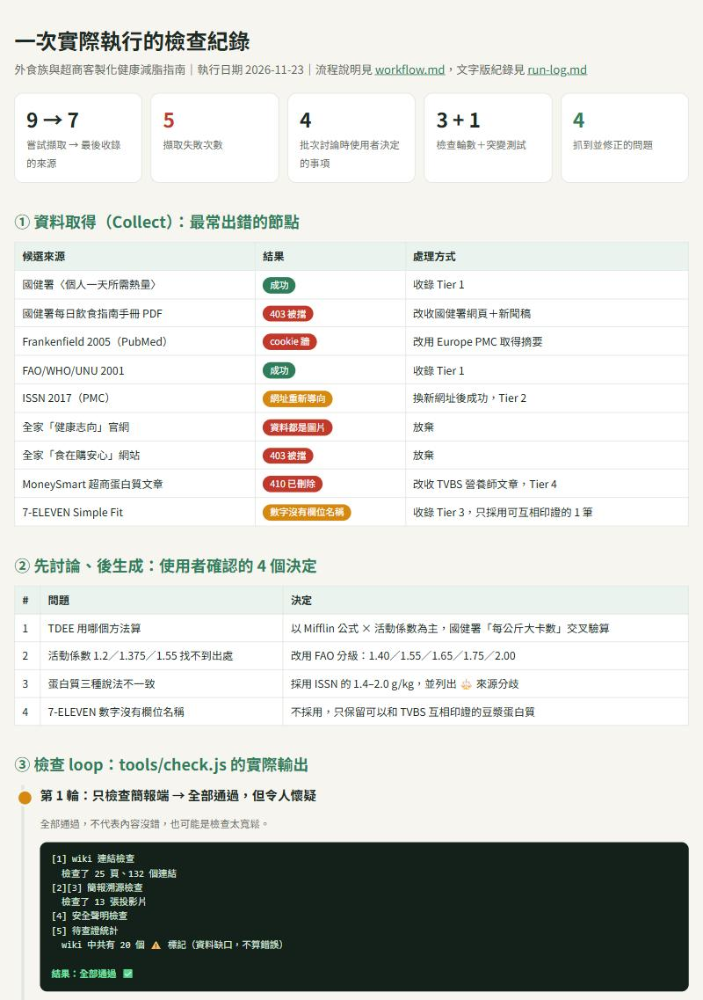
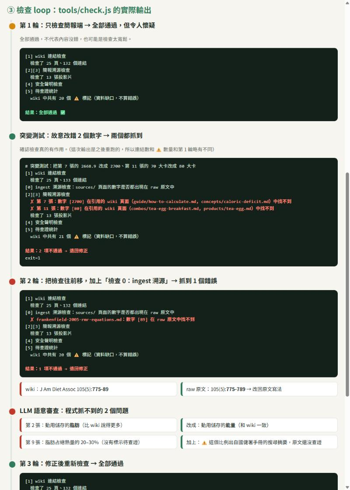
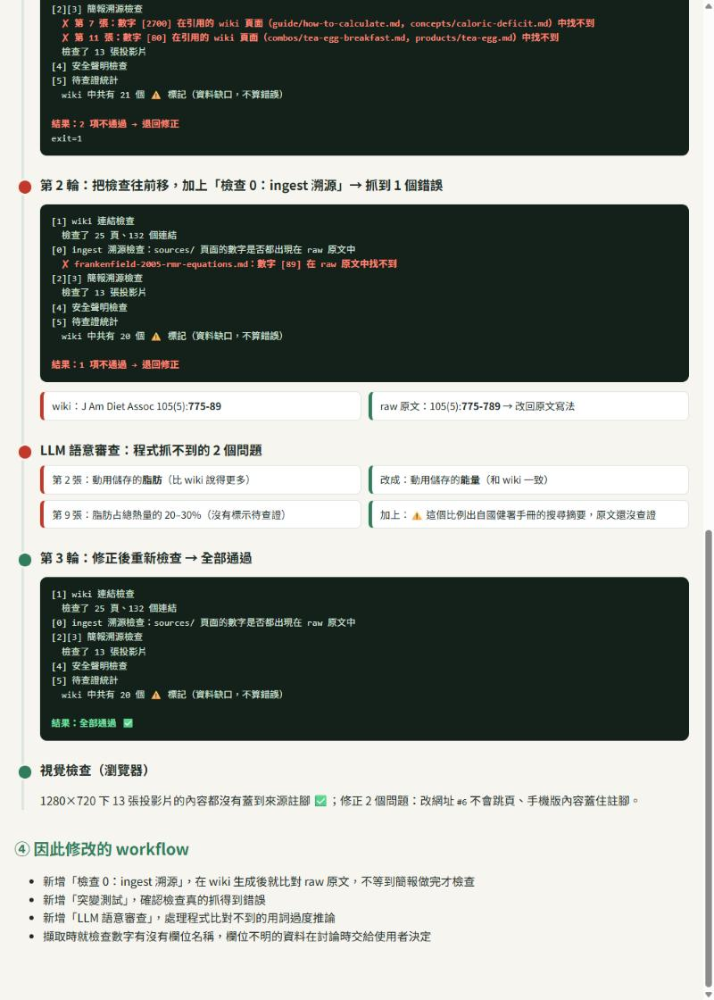

# 外食族與超商客製化健康減脂指南｜LLM Wiki

> 課程作業：用 LLM Wiki 做一份教學 HTML 簡報

## 1. LLM Wiki 主題與簡短介紹

**主題：外食族與超商客製化健康減脂指南**

這是一份給台灣外食族的減脂知識庫，參考 Karpathy 提出的 LLM Wiki 架構：使用者負責挑選資料和做決定，LLM 負責閱讀、整理、交叉連結和維護。架構分成三層：

| 層 | 內容 |
|---|---|
| `raw/` | 原始資料，存入後不再修改。共 7 份：國健署 2 份、FAO/WHO/UNU 2001、Frankenfield 2005 系統性回顧、ISSN 2017 立場聲明、7-ELEVEN 官網、TVBS 營養師文章 |
| `wiki/` | 由 LLM 撰寫的 22 頁知識頁：概念（BMR、TDEE、熱量赤字、蛋白質…）、指南、活動量分級、商品、餐點組合、個人化方案範例、來源摘要 |
| `CLAUDE.md` | Schema：規定頁面格式、證據分級（Tier 1–4）、排除族群，以及 collect、ingest、query、lint、slides 五個流程 |

**特色**：使用者輸入身高、體重、運動習慣和預算，wiki 就能算出 BMR、TDEE、目標熱量和蛋白質，再搭配超商餐點。每個數字都可以從「簡報 → wiki → raw 原文」一路追溯。

## 2. LLM Wiki 連結與成果

- GitHub repo：https://github.com/w840306w/taica_-1110
- 目錄：[wiki/index.md](wiki/index.md)
- 首頁：[wiki/overview.md](wiki/overview.md)
- 操作日誌：[wiki/log.md](wiki/log.md)
- Schema：[CLAUDE.md](CLAUDE.md)

## 3. 教學 HTML 簡報

- 線上瀏覽：**https://w840306w.github.io/taica_-1110/slides/**
- 原始檔：[slides/index.html](slides/index.html)：共 13 張，用方向鍵或右下角按鈕切換

## 4. Loop / Graph 設計

完整說明與 Mermaid 流程圖：[docs/workflow.md](docs/workflow.md)

```
取得資料 → 人工審核 → 存入 raw → 批次討論（先討論）→ 生成 wiki（後生成）
  → 檢查 0：ingest 溯源 → 查詢 wiki → 產生簡報
  → 檢查 1–4：程式檢查 → LLM 語意審查 → 瀏覽器視覺檢查 → 輸出
（任何一個檢查不通過，就退回上一個生成節點；wiki 中的 ⚠️ 資料缺口，會回到「取得資料」）
```

## 5. 一次實際執行的結果與檢查紀錄

- **視覺化檢查報告（線上）**：**https://w840306w.github.io/taica_-1110/docs/check-report.html**







- [docs/run-log.md](docs/run-log.md)：擷取失敗 5 次、4 個討論決定、3 輪檢查和 1 次突變測試
- 檢查原始輸出：[第 1 輪](docs/check-round1.txt)、[突變測試](docs/check-mutation.txt)、[第 2 輪](docs/check-round2.txt)、[第 3 輪](docs/check-round3.txt)
- 檢查工具：[tools/check.js](tools/check.js)

## 6. 反思

完整內容：[docs/reflection.md](docs/reflection.md)

- **最常出錯的節點：資料取得**。9 次擷取有 5 次失敗；7-ELEVEN 頁面的數字沒有欄位名稱；LLM 預設的活動係數也找不到出處。
- **檢查往前移**：從「簡報產生後」往前移到「wiki 生成後」（新增 ingest 溯源檢查，抓到頁碼寫錯），再往前移到「擷取時」（檢查欄位是否清楚）。
- **修改 workflow**：新增檢查 0、突變測試（確認檢查真的抓得到錯誤），以及 LLM 語意審查（抓到「脂肪」和「能量」的用詞過度推論）。

---
本指南僅供一般健康成人參考，不能取代醫療建議；若有疾病或特殊狀況，請諮詢醫師或營養師。
