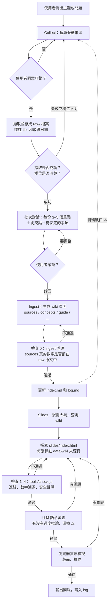

# Loop / Graph 設計說明

## 流程圖

文字版：

**取得資料 → 人工審核 → 存入 raw → 討論重點 → 生成 wiki → 溯源檢查 → 查詢 wiki → 產生簡報 → 自動檢查 → 語意審查 → 視覺檢查 → 輸出**

## 每個節點做什麼

| 節點 | 執行者 | 產出 |
|---|---|---|
| Collect | LLM 搜尋，使用者同意後才存檔 | `raw/` 檔案，附 YAML 開頭（網址、tier、取得日期） |
| 討論 | LLM 提出重點和待決定事項，使用者拍板 | 決定會寫進 `wiki/log.md` 和 `docs/run-log.md` |
| Ingest | LLM | `wiki/` 頁面，每個數字都要附來源連結；有衝突時寫「⚖️ 來源分歧」 |
| 檢查 0 | `tools/check.js`（程式） | 比對 sources 頁的數字和 raw 原文 |
| Slides | LLM，只能使用 wiki 的內容 | `slides/index.html`，每張用 `data-wiki` 標註引用的頁面 |
| 檢查 1–4 | `tools/check.js`（程式） | 連結是否斷掉、簡報上的數字是否出現在引用的頁面、免責聲明和排除族群是否存在 |
| 語意審查 | LLM 自己檢查 | 有沒有比 wiki 說得更多、有沒有漏掉 ⚠️ 標記 |
| 視覺檢查 | 瀏覽器實際打開 | 版面有沒有超出、操作是否正常 |

## 哪些步驟會重複執行？

1. **Collect → 擷取**：抓不到資料或欄位不明時，就回去換一個來源（這次執行重複了 5 次）
2. **討論 → 確認**：使用者想調整時，重新整理重點
3. **Ingest → 檢查 0**：數字和原文對不上，就回去修改 wiki 頁面
4. **撰寫簡報 → 檢查 1–4 → 語意審查 → 視覺檢查**：只要有任何一項不通過，就回去修改簡報
5. **長期循環**：wiki 中的 ⚠️ 標記（目前有 20 個）就是下一輪 Collect 的待辦清單

## 哪些地方需要檢查或重新生成？

- **擷取後**：數字有沒有欄位名稱、網頁是不是圖片或被擋
- **生成 wiki 後**：數字能不能追溯到 raw 原文
- **生成簡報後**：數字能不能追溯到 wiki、有沒有超出 wiki 的說法、安全聲明有沒有出現、版面是否正常

## 為什麼這樣設計？

1. **健康資訊錯了會有實際傷害**。所以每個數字都要能從「簡報 → wiki → raw」一路追溯回原文，也就是三層溯源。
2. **LLM 擅長生成，不擅長自我察覺錯誤**。能用程式檢查的部分，例如數字比對和連結檢查，就交給 `check.js`，因為程式的結果比較穩定。語意層面的問題才交給 LLM 審查。
3. **人工介入放在決策點**。收錄哪些來源、來源之間衝突時採用哪個，都牽涉價值判斷，所以交給使用者決定。重複性的整理工作交給 LLM。
4. **wiki 是會累積的知識庫**。簡報只是從 wiki 產生的一種輸出；之後要做別的成果（例如個人化方案），也是從同一份 wiki 查詢，不用重新讀一遍資料。
